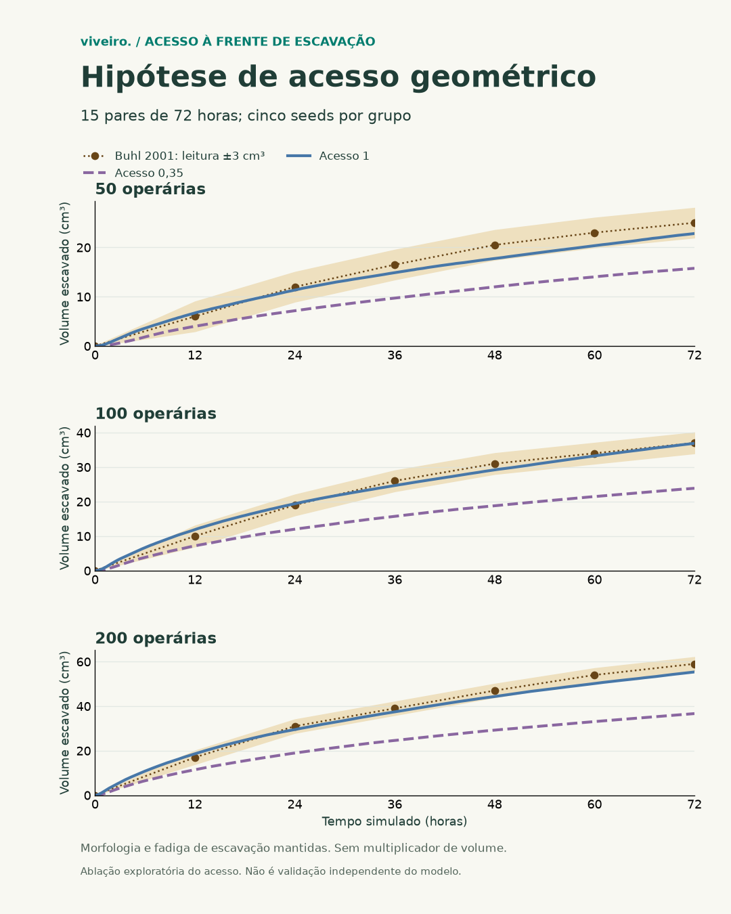

# Buhl — acesso à frente com corpos explícitos

07/11/2026. Hipótese formulada após examinar os três primeiros braços do
ensaio de locomoção e o código, antes de executar este diagnóstico.
É investigação exploratória posterior, não pré-especificação retroativa.
Não acrescenta casos nem altera parâmetros do lote fatorial de 72 h.

## Motivo e contraste fixado

O registro de [ajuste antigo](buhl-ajuste.md) define `contactAccess` como
fração de oportunidades em que uma operária consegue acessar uma face,
uma hipótese para a aproximação de uma operária por célula. O valor 0,35
foi escolhido olhando o volume de 12 h. Com a exclusão corporal explícita,
o fator permanece multiplicando as chances de iniciar escavação.
Isso pode representar parte da restrição de acesso duas vezes; ainda não
é uma causa demonstrada da discrepância com Buhl.

Comparar somente `contactAccess: 0.35` com `contactAccess: 1`. O segundo
remove a redução fenomenológica adicional; as restrições físicas entre
corpos e a chance local de cavar continuam. Não se escolhe um valor
intermediário para aproximar o volume observado.

Manter Narbonne v2, caminhada térmica de 11,0222 mm/s a 24 °C, carga 0,85,
fadiga de escavação, densidade, dimensões, passos, tempo e massa por pelota.
50/100/200 operárias, cinco seeds pareadas, horizonte de apenas 7.200 s.
A base é o braço `base` do piloto já concluído, reproduzido exatamente.
[Plano de entrada](../validacoes/buhl-acesso-geometrico-piloto-plano.json).

## Execução e interpretação

Iniciar somente depois de terminar o único coordenador de 72 h.

```powershell
node scripts/sweep-buhl-arena.ts --plan docs/validacoes/buhl-acesso-geometrico-piloto-plano.json --out .runtime/buhl-acesso-geometrico-piloto --jobs 6
```

Medir volume aberto, massa removida, inícios de escavação, tempo cavando,
tempo com carga e bloqueios, com diferenças pareadas nas mesmas seeds.
Conferir hashes, balanços e portes idênticos. Registrar o resultado mesmo
se o efeito for pequeno ou desfavorável. A saída de 2 h não é uma curva
de 72 h, nem demonstra que o volume de Buhl foi reproduzido.

Outra hipótese separada: em reentrâncias, a regra exige uma nova face de
contato para tentar cavar. Uma operária imobilizada pode não renovar essa
oportunidade. Este diagnóstico não muda a regra nem inventa uma frequência
de contato antenal; sua representação e evidências precisam ser investigadas.

A remoção do fator é uma ablação da hipótese de acesso, sem promoção
automática ao padrão do terrário. B7 continua aberto. Dados anteriores
permanecem preservados; nenhum fator de produtividade 1,6 será aplicado.

## Piloto concluído e continuação fixada

15 rodadas de 2 h, 105 amostras, balanços preservados e fenótipos idênticos.
A mudança de acesso 0,35 → 1 elevou o volume médio de 0,282 → 0,884 cm³
(50), 0,861 → 2,055 cm³ (100) e 1,908 → 3,755 cm³ (200).
Razões: 3,14/2,39/1,97. [CSV](../validacoes/buhl-acesso-geometrico-piloto.csv)
e [planos, pares e hashes](../validacoes/buhl-acesso-geometrico-piloto.json).
Isso mede influência no modelo; não justifica extrapolação para 72 h.

Após esse piloto, fixar o mesmo contraste em 72 h, sem escolher valor
intermediário. [Plano de 72 h](../validacoes/buhl-acesso-geometrico-72h-plano.json).
A base são as 15 rodadas completas do braço base do fatorial. Usar o mesmo
motor/fingerprint, propriedades corporais e parâmetros individuais; gerar
mais 15 rodadas com acesso 1. Essa continuação é exploratória após o piloto.
Comando: `node scripts/sweep-buhl-arena.ts --plan docs/validacoes/buhl-acesso-geometrico-72h-plano.json --out .runtime/buhl-acesso-geometrico-72h --jobs 6`.

## Resultado de 72 horas — concluído

As 15 rodadas concluíram com os mesmos portes, velocidade, carga e fadiga
individual da base; só o fator adicional de acesso mudou. Os 15 pares
tiveram diferença positiva de volume final. Os balanços fecharam nas
3.255 amostras e o trânsito abriu zero células de areia.

| Operárias | Base 0,35 (cm³) | Acesso 1 (cm³) | Ganho da média | MAE da curva (cm³) | Pontos na faixa de leitura |
| --- | ---: | ---: | ---: | ---: | ---: |
| 50 | 15,76 | 22,82 | +44,7% | 1,75 | 6/6 |
| 100 | 23,86 | 36,88 | +54,6% | 1,05 | 6/6 |
| 200 | 36,66 | 55,36 | +51,0% | 2,47 | 4/6 |

Médias de cinco seeds por grupo, sem multiplicador de volume. Os desvios
padrão simulados em 72 h foram 2,83/1,86/5,57 cm³. A inclinação log-log
foi 0,639, dentro da faixa construída da digitalização (0,500–0,747).
A faixa ±3 cm³ pertence à leitura da curva de 2001, não à variabilidade
biológica: foram 16/18 pontos dentro dela. Para 200 operárias, os desvios
em 60 e 72 h foram −3,83 e −3,64 cm³, fora dessa faixa.

A tabela de 2005 tem médias finais diferentes: 25,35/37,15/65,27 cm³,
com DP 11/9,2/22,4. As médias simuladas ficaram em média ± DP nos três
grupos. Essa descrição não é um teste estatístico nem aceite de validação.
Os dados de 2001/2005 já informaram decisões do projeto e não são independentes.

[CSV das 3.255 amostras](../validacoes/buhl-acesso-geometrico-72h.csv) ·
[Planos, pares, hashes e diagnóstico](../validacoes/buhl-acesso-geometrico-72h.json).



## Interpretação e próximo passo

O ensaio demonstra influência causal do fator de acesso dentro deste modelo,
com resultados compatíveis com a hipótese de restrição excessiva. Não prova
que toda a discrepância vinha de contagem dupla ou que a biologia foi validada.
O ganho foi de 1,45–1,55, não exatamente 1,6, e as diferenças tardias continuam.
A retirada do filtro é uma referência experimental plausível quando o corpo
já restringe o acesso, sem promover automaticamente regras ao terrário.

A regra de contato novo em reentrâncias ainda precisa de microensaio próprio
para verificar imobilização e renovação de tentativas; nenhum período de
contato antenal foi inventado nesta entrega. Também permanecem abertas as
hipóteses de fadiga e passagem por cima de outras operárias. Não ajustar
esses mecanismos apenas para eliminar o resíduo observado.

Próxima entrega técnica: terminar a escala física do cenário com o motor
real World no PR #128. Seus agentes e ambiente precisam ser avaliados
separadamente; o resultado desta arena não valida automaticamente o 3D.
B7/P3.3 continuam abertos para dados empíricos reservados e avaliação independente.

Conferência: modelo da fonte `906ffac32087cceef13d3c8d97261a8385eca4a9`,
Node 24.22.1, hashes/planos por rodada e pós-processamento identificado no recibo.
O piloto foi arquivado com o script da revisão `ea885f3`; o script atual
suporta os dois horizontes e preserva recibos antigos sem sobrescrever.
