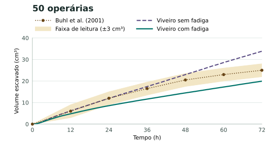
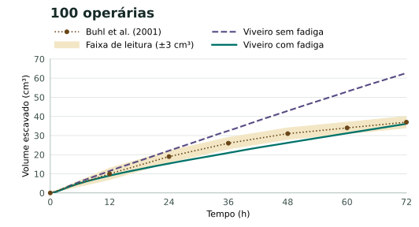
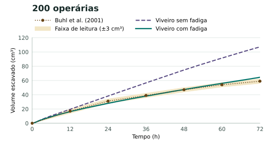

# Buhl — hipótese de fadiga na escavação

Protocolo fixado antes de executar a comparação. Buhl et al. discutem a
exaustão individual como possível explicação para a atividade residual
menor no laboratório. O estudo não fornece uma medida da resposta ao
esforço ou da recuperação. [Discussão de Buhl et al. (2005)](https://doi.org/10.1007/s00265-004-0906-2).

## Regra e controle

Cada operária mantém uma dívida de esforço `W`, em segundos. A dívida
diminui exponencialmente entre registros de trabalho, com meia-vida
de 24 h simuladas. Ao terminar uma tentativa, a operária soma o tempo
que passou cavando, inclusive se outra operária já removeu o material.
A próxima decisão local de cavar é aceita com probabilidade
`1 / (1 + W / 3600)` depois da decisão usual de contato. Uma hora de
dívida reduz essa probabilidade à metade. Os dois valores são
hipóteses exploratórias e foram fixados antes do lote. O esforço
altera a decisão de iniciar. Relógio físico, massa por pelota, tempo
por tentativa, movimento e transporte mantêm os parâmetros do controle.

A regra usa somente o histórico da própria operária. Não há meta de
volume, contagem do grupo, hora programada de parada ou dados
observados dentro do agente. A variante tem uma sequência aleatória
separada para a decisão adicional. O controle conserva a sequência
anterior. O pareamento fixa a seed e a posição inicial. Trajetórias
podem divergir após a primeira decisão diferente.

- [Controle, seguimento com acesso 0,35](../validacoes/buhl-fadiga-controle-plano.json).
- [Variante, seguimento com fadiga local](../validacoes/buhl-fadiga-local-plano.json).

São cinco seeds inéditas de desenvolvimento por grupo e por variante,
para 50, 100 e 200 operárias durante 72 h. Cada rodada tem amostras
a cada 20 minutos e é gravada ao terminar. As partições anteriores
permanecem arquivadas. A curva digitalizada usada na comparação
faz parte da referência de desenvolvimento. A validação em réplicas
empíricas independentes segue pendente.

## Comparação prevista

- Comparar o erro absoluto médio nas 12, 24, 36, 48, 60 e 72 h e a
  cobertura na faixa de leitura de ±3 cm³ por grupo. Relatar também
  os volumes de 72 h frente à tabela de 2005 e a inclinação log-log.
- Medir separadamente o erro no volume de 12 h e a taxa média de
  escavação de 48 a 72 h. Relatar diferenças pareadas por seed.
- Considerar a variante promissora para nova avaliação somente se
  reduzir o MAE nos três grupos, deixar as três médias de 12 h na
  faixa de leitura e aproximar a taxa tardia em pelo menos dois grupos.
  Preservar resultados desfavoráveis mesmo se algum indicador melhorar.
- Verificar a conservação de massa e de células e a abertura zero por
  trânsito em todas as amostras. A concordância numérica de um lote
  não encerra P3.2 ou P3.3.

## Preferência para os próximos ensaios

Em 07/11/2026, o mantenedor escolheu a fadiga apenas de escavação como
referência principal para continuar a investigação. Usar o plano explícito
`buhl-fadiga-local-plano.json`; preservar o controle e os planos legados.
O aceite científico continua em aberto, incluindo o desvio com 50 operárias.
[Imagens para compartilhar e distinção entre as referências](buhl-graficos.md).

## Reprodução

```sh
node scripts/sweep-buhl-arena.ts --plan docs/validacoes/buhl-fadiga-controle-plano.json --out .runtime/buhl-fadiga-controle --jobs 6
node scripts/sweep-buhl-arena.ts --plan docs/validacoes/buhl-fadiga-local-plano.json --out .runtime/buhl-fadiga-local --jobs 6
node scripts/assess-buhl-arena.ts .runtime/buhl-fadiga-controle/series.json
node scripts/assess-buhl-arena.ts .runtime/buhl-fadiga-local/series.json
```

## Resultado do lote

As 30 rodadas geraram 6.510 amostras com balanços de massa e de células
preservados. A seta indica controle → fadiga. A referência de taxa usa
os volumes digitalizados de 48 e 72 h de 2001. A média final observada
vem da tabela 1 de Buhl et al. (2005).

### Curvas de 0 a 72 h

Os círculos mostram os pontos lidos da Figura 2a de Buhl et al. (2001).
A linha pontilhada e a faixa sombreada guiam a leitura entre esses pontos.
A faixa representa a estimativa de ±3 cm³ da digitalização. O ponto inicial
é zero. As linhas do Viveiro mostram a média de cinco seeds pareadas, com
uma amostra a cada 20 minutos em cada rodada. Os gráficos compartilham
a escala de tempo e usam escalas de volume ajustadas por grupo.
[Fonte e critérios da leitura](buhl-criterios.md).







As figuras podem ser geradas novamente a partir dos CSVs arquivados com
`python scripts/plot-buhl-fatigue.py` em um ambiente com Matplotlib 3.11.2.

### Resultados numéricos

| Operárias | Volume em 12 h (cm³) | Volume em 72 h (cm³) | Buhl em 72 h (cm³) | Taxa de 48 a 72 h (cm³/h) | Taxa de referência (cm³/h) | MAE da curva (cm³) |
| --- | ---: | ---: | ---: | ---: | ---: | ---: |
| 50 | 6,12 → 4,82 | 33,82 → 19,92 | 25,35 | 0,453 → 0,226 | 0,188 | 3,00 → 4,39 |
| 100 | 11,55 → 9,06 | 62,67 → 36,15 | 37,15 | 0,824 → 0,414 | 0,250 | 11,28 → 3,01 |
| 200 | 19,57 → 16,32 | 107,12 → 64,46 | 65,27 | 1,352 → 0,716 | 0,500 | 23,44 → 2,07 |

Na ordem de 50, 100 e 200 operárias, a cobertura da faixa de leitura foi
67% → 17%, 17% → 50%, 17% → 67%. As inclinações log-log foram 0,832 e 0,847
para controle e fadiga. A faixa de referência é 0,500 a 0,747.

As médias de 12 h ficaram na faixa de leitura nos três grupos, e a taxa
tardia se aproximou da referência em todos eles. O MAE caiu nos grupos
de 100 e 200 operárias e aumentou no grupo de 50. A inclinação também se
afastou ligeiramente da faixa de referência.

A variante ficou aquém dos critérios pré-especificados e permanece
experimental. O resultado mostra que a regra reduz a atividade tardia
no modelo. A causa do padrão observado nas operárias reais e a escala de
resposta ao esforço continuam em aberto. A evidência anterior está no
[relatório de 72 h](../validacao.md).

- [Comparação, pares por seed e hashes](../validacoes/buhl-fadiga-comparacao-72h.json).
- [Série de controle](../validacoes/buhl-fadiga-controle-72h.csv).
- [Série com fadiga](../validacoes/buhl-fadiga-local-72h.csv).
- [Fonte registrada antes de executar o lote](https://github.com/albreis/viveiro/tree/2be875ba67da45df10c56875615c6a7aa82e1449).
