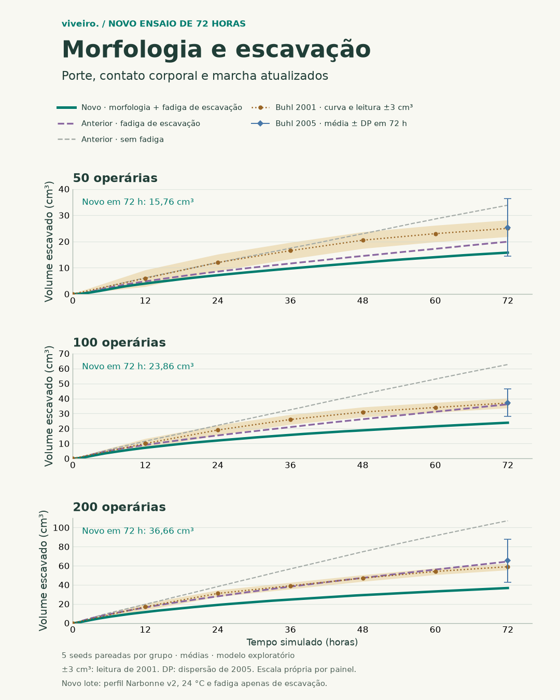

# Buhl — transferência do perfil de operárias de Narbonne

Protocolo fixado em 07/11/2026 antes do novo lote de 72 horas. Os PRs
#123 e #124 já estão integrados. Este ensaio liga suas regras de operárias
à arena física e mede o efeito do conjunto no gráfico principal de solo
removido. Mantém cinco seeds pareadas por grupo, com 50, 100 e 200 operárias.
Usa apenas fadiga de escavação (`work-recovery`).

## O que foi transferido

- A função compartilhada de porte nominal de 4–8 mm, referência de 5 mm
  e cabeça proporcionalmente maior nas operárias grandes. A distribuição
  favorece portes menores e continua sendo uma hipótese ilustrativa.
- A mesma resposta da caminhada à temperatura, nas âncoras de Challet,
  com 24 °C fixados como condição exploratória do Viveiro.
- A penalidade de carga de terra em galerias do perfil v2, fator 0,85
  com uma carga completa. Massa por pelota e tempo por tentativa ficam intactos.
- A elipse de contato entre operárias do motor 3D, convertida em milímetros
  e projetada no plano. O porte agora afeta o espaço de encontro entre agentes.
  A regra permite sair de sobreposição existente e tenta os desvios cardinais.

A arena mantém centros na grade, geometria plana e exclusão de uma célula.
A elipse amplia a checagem entre agentes. O contato com o solo continua pela
grade; não é uma malha 3D completa de corpo e terreno. A cabeça fica registrada
no fenótipo, enquanto o contato usa a escala corporal da mesma regra 3D.
Genomas, envelhecimento e naníticas não são gerados nesse ensaio de operárias
adultas. A distribuição compartilhada é a referência anterior a esses efeitos.

O plano exige `workerProfile` e microclima explícitos. Planos sem a referência
conservam a dinâmica e a sequência aleatória anteriores. Tamanhos usam hash
independente, sem consumir o gerador das decisões. Metadados registram o perfil,
o porte por indivíduo, velocidades aplicadas e candidatos rejeitados por contato.

## Condições e critérios

O [plano](../validacoes/buhl-narbonne-operarias-plano.json) fixa 24 °C,
água relativa da areia 0,08, umidade do ar 0,8, fluxo zero e secagem desativada.
A água neutra mantém o fator de tempo por pelota em um. Esses números não
são uma reconstrução das condições ausentes do estudo de Buhl.

Foram comparadas as séries novas às séries arquivadas de controle e de fadiga
de escavação, nas mesmas cinco seeds. Relatar volume em 12 e 72 horas, MAE nos
seis tempos de 12 a 72 horas, cobertura da leitura ±3 cm³, taxa tardia,
diferenças pareadas e dispersão. Preservar resultados desfavoráveis.
A temperatura e as regras de contato/carga mudam juntas; o lote não isola
seus efeitos individuais e não encerra B7.

Todos os balanços de massa e células devem se conservar. Trânsito deve continuar
abrindo zero células de areia. Nenhum fator novo de produtividade, força de
mandíbula ou escavação por porte foi inventado. Não há ajuste para atingir
o volume de referência. A curva de 2001 e a tabela de 2005 ficam separadas.

Rainha, macho, voo, calendário e dieta de fundação não fazem parte do protocolo
com grupos fixos de operárias. Parede e teto não têm graus de liberdade na
arena plana; seu fator de marcha não é aplicado como se todas as operárias
estivessem escalando. O relógio continua em segundos físicos.

## Execução

```powershell
node scripts/sweep-buhl-arena.ts --plan docs/validacoes/buhl-narbonne-operarias-plano.json --out .runtime/buhl-narbonne-operarias-72h --jobs 6
```

O lote é retomável com `--resume` na mesma fonte. Não mudar módulos do motor
durante sua execução, substituir a pasta ou iniciar outro executor.
As 15 rodadas terminaram. O próximo diagnóstico é separar temperatura,
contato corporal e carga em ablações pareadas, fixando os planos antes
de executar e conservando a comparação empírica independente de B7.

## Resultado das 15 rodadas

Fonte das rodadas: `046542f9988f9131abde961f073752b699de9f7b`.
Node 24.22.1, aritmética nativa. O novo lote gerou 3.255 amostras e
1.750 fenótipos individuais registrados. O eixo das curvas é o volume
novo de galeria aberta no disco (`voidVolumeCm3`); o CSV também preserva
volume removido por massa e areia parcialmente escavada.



| Operárias | Fadiga anterior em 72 h | Nova configuração em 72 h | Tabela de Buhl 2005 | MAE anterior → novo |
| --- | ---: | ---: | ---: | ---: |
| 50 | 19,92 cm³ | 15,76 cm³ | 25,35 cm³ | 4,39 → 6,72 cm³ |
| 100 | 36,15 cm³ | 23,86 cm³ | 37,15 cm³ | 3,01 → 9,67 cm³ |
| 200 | 64,46 cm³ | 36,66 cm³ | 65,27 cm³ | 2,07 → 15,52 cm³ |

O desvio padrão entre as cinco seeds no ponto final foi 0,69, 0,94 e
2,59 cm³, respectivamente. As diferenças pareadas médias foram
−4,16, −12,29 e −27,80 cm³. Todas as 15 diferenças individuais foram negativas.

Os volumes e o MAE das curvas pioraram nos três grupos. A cobertura
da faixa de leitura ficou em 16,7%, 16,7% e 0%. A faixa de ±3 cm³ é
incerteza de digitalização da curva de 2001; a tabela de 2005 tem outra
média final e sua dispersão descritiva própria. As figuras separam ambas.

A inclinação log-log entre grupos passou de 0,847 para **0,609**,
agora dentro da faixa de leitura de 0,500–0,747. Esse é um ganho no
padrão de escala, enquanto os volumes absolutos continuam abaixo das
referências. Não basta para declarar a configuração calibrada.

A marcha sem carga ficou em 11,02 mm/s a 24 °C, frente à âncora de
15,05 mm/s do ensaio antigo sem microclima explícito. Com carga inteira
de terra em galeria, ficou em 9,37 mm/s. A elipse corporal também
rejeitou encontros antes aceitos pela exclusão de uma célula.
Esses mecanismos dão caminhos plausíveis para a redução, mas este lote
não mede a contribuição isolada de cada um.

Os balanços inteiros de massa e células foram preservados nas 3.255
amostras e o trânsito abriu zero células em todas elas. Não se ajustaram
coeficientes após observar essas curvas. A nova opção permanece
experimental. O ensaio antigo e sua interpretação estão preservados.

## Dados, imagens e validação

- [CSV das 3.255 amostras](../validacoes/buhl-narbonne-operarias-72h.csv).
- [Portes e velocidades dos 1.750 indivíduos](../validacoes/buhl-narbonne-operarias-fenotipos.csv).
- [Comparação, planos, pares por seed e hashes](../validacoes/buhl-narbonne-operarias-comparacao.json).
- PNGs individuais: [50](../validacoes/figuras/buhl-narbonne-50-1080x1350.png),
  [100](../validacoes/figuras/buhl-narbonne-100-1080x1350.png) e
  [200](../validacoes/figuras/buhl-narbonne-200-1080x1350.png).
- [Verificações da implementação e equivalência](../validacoes/buhl-narbonne-verificacao.json).

O gerador `scripts/archive-buhl-narbonne.ts` confere os hashes dos registros,
o pareamento com o CSV antigo, todos os balanços e os portes registrados.
`scripts/plot-buhl-narbonne.py` confere SHA-256 e médias antes dos quatro PNGs.

Uma checagem de arquitetura numérica detectou `side ** 2` na alocação
inteira dos buckets. A fonte ficou fixa durante todas as rodadas. Depois
do lote, a expressão foi substituída por `side * side`, sem alteração
biológica. A equivalência inteira foi conferida para todos os tamanhos
de bucket suportados, de 1 a 1.000. A reexecução dos primeiros 1.200 segundos
dos 15 planos preservou as amostras e todos os fenótipos exatamente.
O recibo distingue a impressão digital da fonte das rodadas e a fonte
final. Os dados longos continuam atribuídos à fonte que os produziu.

A conferência de contato comparou dois mil deslocamentos indexados à
função real 3D em apoio plano. O Chrome 157 também executou a arena nova
e confirmou perfil, fenótipos, contatos ativos e balanços. Os saves
do usuário não foram usados para testes. A fonte antiga continua
reproduzindo o controle de Buhl e o CSV/manifesto da v1 do terrário.

A suíte final passou em **542/542 testes**. TypeScript, 1.368 mensagens pt/en
e o build Vite de 491 módulos também passaram. [PR #126](https://github.com/albreis/viveiro/pull/126).
