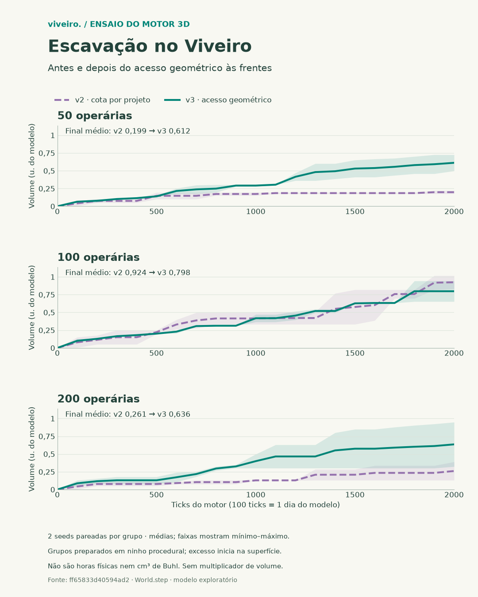
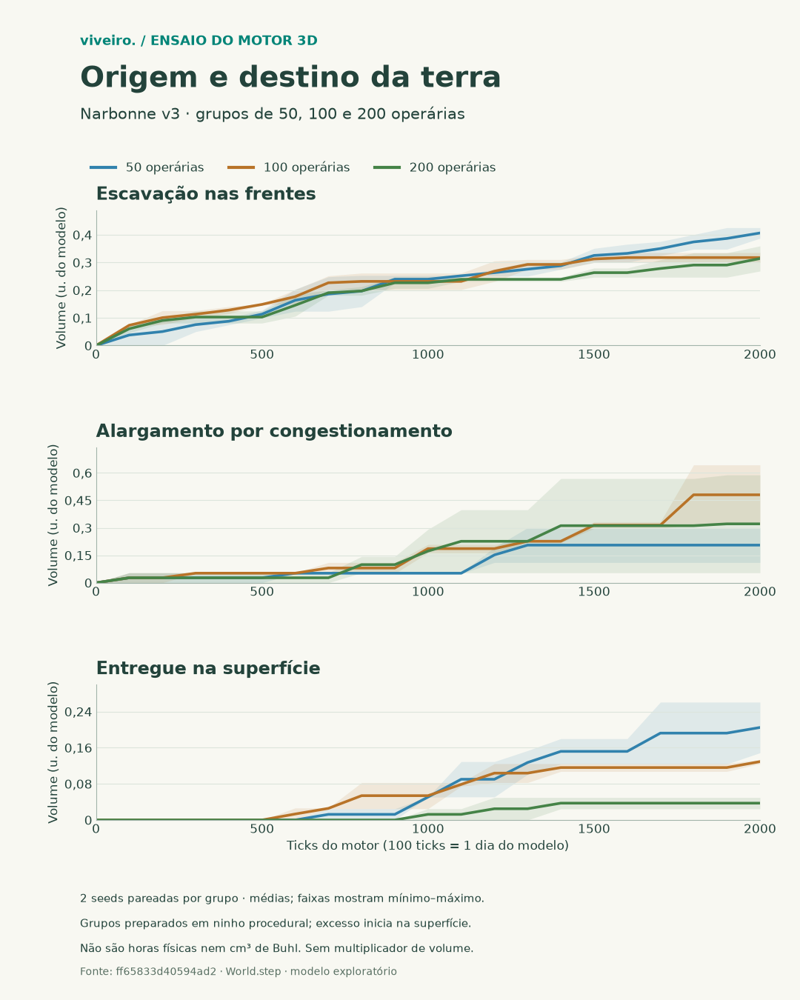
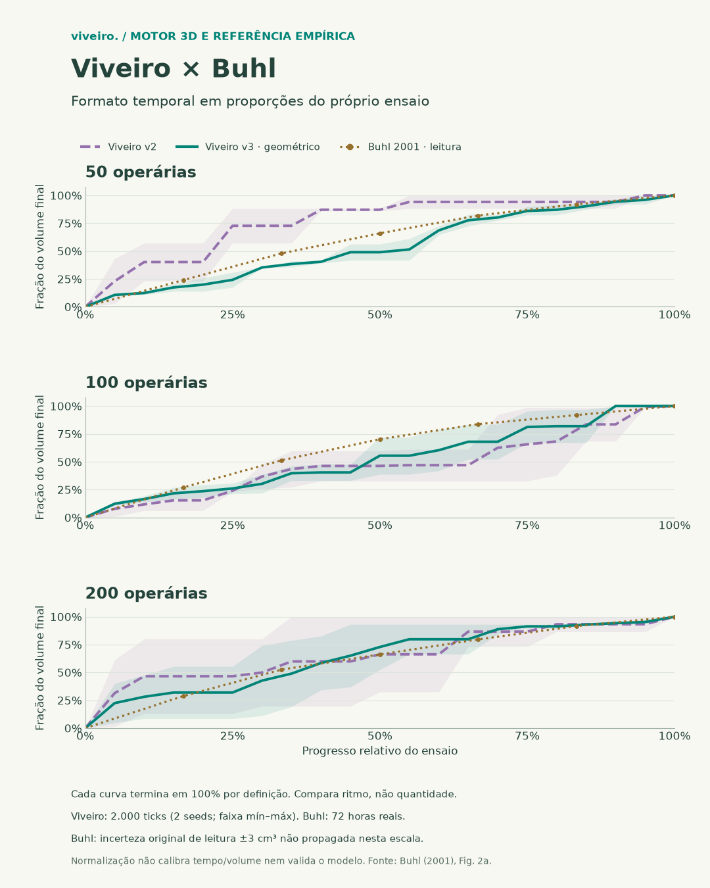
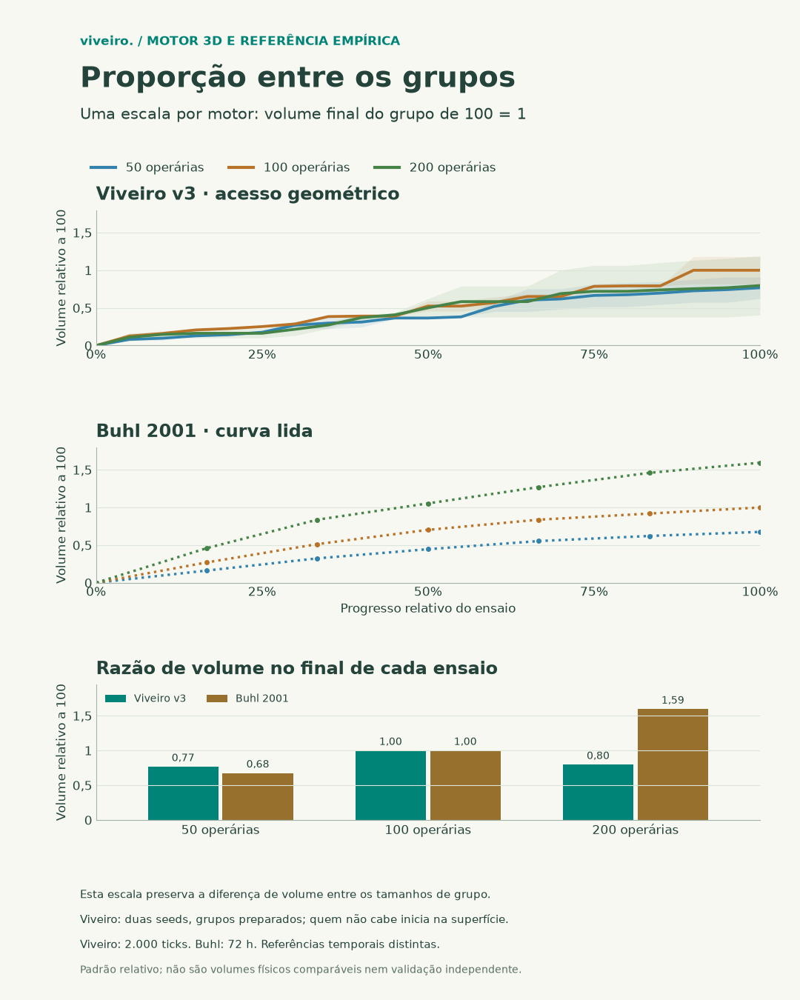

# Acesso geométrico à escavação no motor do Viveiro

07/11/2026. Branch `codex/escavacao-acesso-geometrico-viveiro`, criada de
`origin/main` em `d88c31e`. Implementa o pedido do mantenedor de transferir a
hipótese de acesso ao motor real, preservando a morfologia.

## O que foi transferido

O [PR #130](https://github.com/albreis/viveiro/pull/130) estudou a remoção do
filtro adicional de acesso na arena planar. Esse filtro não existia no
`World` 3D. O terrário tinha outras restrições: uma cota por projeto que
contava também quem já saíra para transportar terra, uma única mordida por
projeto/tick e um único destino aproximado para a frente.

A revisão **Narbonne v3** substitui essas restrições por contato geométrico:

- Procura solo real à frente, incluindo a parede da câmara onde começa uma
  nova galeria. Amostras cobrem diferentes alturas da face, sem cotas de equipe.
- Exige apoio, alcance corporal e ausência de sobreposição para trabalhar.
  Não basta compartilhar o mesmo nó lógico. Vidro não é solo escavável.
- Permite trabalho de mais de uma operária por ciclo quando os corpos cabem.
  Cada agente tem sua guarda de mordida para impedir chamadas duplicadas.
- Caminha até a face com apoio e colisões. Quando o acesso fica ocupado ou
  o desvio falha, recua/transporta sua carga. Não salta até uma vaga.
- Não conta transportadoras distantes como pessoas trabalhando na face.

Não altera o porte, marchas, penalidades de carga, alimentação, calendário,
comprimento por mordida ou capacidade de carga da v2. Não multiplica volume
por 1,6. O módulo de reparo foi separado sem mudar suas regras.

## Compatibilidade

O perfil salvo fixa o comportamento. Novos terrários usam
`messor-narbonne@3`; saves v1/v2 e outros perfis continuam com as regras
anteriores. O seletor descreve a revisão em português e inglês. A versão do
pacote continua 0.47.0; esta entrega não cria tag, release ou depósito Zenodo.

Módulos novos: `soil/access-rule.ts`, `soil/front-access.ts`,
`soil/digging.ts` e `soil/repair.ts`. A consulta de ocupação para uma posição
futura reaproveita o índice espacial, sem a exceção que permite escapar de
sobreposições durante o movimento normal.

## Verificação técnica

Os testes cobrem contato em alturas distintas, ausência de apoio, corpos
sobrepostos, trabalho paralelo, guarda por operária, transportadoras fora da
face, lotação física, recrutamento padrão/estigmérgico e término do segmento.
O ciclo completo usa `World.step`: duas cargas são entregues fora do ninho,
sem saltos, com balanço de terra e futuro idêntico após salvar/restaurar.

O ensaio de integração usa o mesmo `World.step` da interface: grupos
preparados de 50/100/200 operárias, duas seeds, pares Narbonne v2/v3 e 2.000
ticks por execução. Cada par começa com o mesmo estado físico e RNG (hash
conferido, removendo apenas a identificação da revisão). Não há rainha,
prole ou predação; alimento inicial adicional de 200 u.; ar a 24 °C, umidade
68% e vento zero. Outros processos biológicos e ambientais continuam ativos.

Os corpos são posicionados primeiro nas câmaras sem sobreposição; quem não
cabe começa na superfície. A distribuição é igual dentro de cada par, mas
não igual entre tamanhos de grupo. **Este lote testa integração e diferenças
pareadas; não estabelece uma lei de escala com a população.**

Reprodução:

```powershell
node scripts/check-dig-access.ts .runtime/novo-acesso.json 2000
node scripts/qa/dig-access.mjs
npm test
npm run build
```

O CLI exige um arquivo novo e arquiva o resultado antes de rejeitar um
balanço/deslocamento fora do limite, preservando também ensaios desfavoráveis.

## Alcance científico

Esta é uma alteração exploratória de mecanismo. Buhl já influenciou a escolha
da hipótese; continua dado de desenvolvimento, sem voltar a ser validação
independente. A revisão anterior e os resultados que a desfavorecem continuam
arquivados. A inferência de dupla restrição é hipótese, não fato biológico.

O lote do terrário usa ticks e volumes do modelo. **Não é uma repetição das
72 horas físicas da arena nem uma nova curva em cm³ de Buhl.** O terrário
mantém sua fisiologia anterior: não recebeu silenciosamente a fadiga de
escavação, a duração de coleta ou a conversão de tempo da arena. Essas pontes
exigem protocolo próprio antes de qualquer alegação quantitativa.

A forma/alcance dos corpos, discretização da face, volume aproximado das
cápsulas e ordem sequencial das mordidas continuam limitações do modelo. O
[ODD](../odd/submodelos.md) registra as regras. B7 e a calibração não são
encerrados por estes testes.


## Resultado das 12 execuções

547/547 testes aprovados; build com 493 módulos e catálogos pt-BR/en
conferidos. Chrome 157.0.8103.38: duas línguas, perfil v3, 50 agentes,
visões lateral/primeira pessoa e retomada do relógio. Os 120 ticks executados
no navegador são numericamente idênticos à CLI. [Evidência técnica](../validacoes/escavacao-acesso-viveiro-qa.json).

Médias no tick 2.000, em unidades de volume do modelo:

| Operárias | Total v2 | Total v3 | Frentes v2 | Frentes v3 | Entregue v2 | Entregue v3 |
| --- | --- | --- | --- | --- | --- | --- |
| 50 | 0,199 | 0,612 | 0,100 | 0,407 | 0,121 | 0,205 |
| 100 | 0,924 | 0,798 | 0,087 | 0,318 | 0,179 | 0,129 |
| 200 | 0,261 | 0,636 | 0,077 | 0,314 | 0,025 | 0,037 |

A escavação nas frentes aumentou nos três grupos. O total inclui também
alargamentos por congestionamento: no grupo de 100 caiu na revisão nova,
mesmo com mais escavação frontal. A entrega na superfície também não aumenta
uniformemente. Estas diferenças e as duas seeds foram preservadas.

Todas as 12 execuções terminaram com a população inicial. Maior resíduo do
balanço de terra: 3,75e−16 u.; maior deslocamento por tick: 0,923 × velocidade
nominal do agente; maior afastamento observado do apoio: 0,0406 u. São medidas
de integração, não estimativas de comportamento real. Duas seeds não
caracterizam adequadamente a incerteza biológica.

[Dados completos](../validacoes/escavacao-acesso-viveiro.json), com hash do
estado inicial de cada par e fingerprint do motor. Os dados usam o motor
registrado em `acbc1e1`; o manifesto conserva `d88c31e` como base da branch.
A identidade normalizada dos módulos é
`ff65833d40594ad241bac893602b2895970df028c51220840f5087cc51c12e45`.





## Comparação relativa com Buhl

A pedido do mantenedor, os gráficos seguintes comparam **padrão relativo**,
sem converter unidades nem ajustar o motor. Usam a [curva lida em 2001](../validacoes/buhl-curva-2001-referencia.json),
já arquivada no projeto; a faixa original de ±3 cm³ é incerteza de leitura,
não desvio-padrão de réplicas. Não foram introduzidos números da tabela de 2005.

1. **Ritmo temporal:** x = t/T; y = V(t)/V(T). Cada réplica do Viveiro é
   normalizada pelo próprio volume final antes de calcular a média e a faixa
   mínimo–máximo. Buhl usa os pontos da curva lida e seu último ponto. Todas as
   curvas terminam em 100% por definição. Esta figura compara a distribuição
   temporal do trabalho e **esconde diferenças de volume entre grupos**.
2. **Proporção entre grupos:** x = t/T; y = V_N(t)/V_100(T). O Viveiro usa o
   volume final médio do grupo 100 como denominador único; Buhl usa 37 cm³,
   o ponto final lido do grupo 100. Assim, a diferença entre os tamanhos de
   grupo permanece. O relógio do terrário continua em 2.000 ticks do modelo;
   o experimento de Buhl continua em 72 h reais. A normalização não calibra
   essas escalas nem converte este lote em validação.

Na segunda definição, as razões finais de 50/100/200 são **0,77/1/0,80** no
Viveiro e **0,68/1/1,59** na curva lida de Buhl. Logo, a proporção entre os
grupos ainda difere, especialmente para 200. A inicialização mista
(câmaras/superfície) e o transporte precisam de um protocolo controlado antes
de atribuir isso a uma regra biológica. Não se deve escolher fatores só para
impor a ordem observada em Buhl.





Regerar as figuras com os mesmos dados:

```powershell
python scripts/plot-dig-access.py docs/validacoes/escavacao-acesso-viveiro.json docs/validacoes/figuras
python scripts/plot-dig-access-relative.py docs/validacoes/escavacao-acesso-viveiro.json docs/validacoes/buhl-curva-2001-referencia.json docs/validacoes/figuras
```

Requer matplotlib e numpy. As figuras são derivadas dos dados arquivados,
sem novas execuções do motor, suavização que mude os pontos ou multiplicador
oculto. A incerteza de digitalização de Buhl não foi propagada para a escala
relativa; esses desenhos não sustentam um teste estatístico de equivalência.
