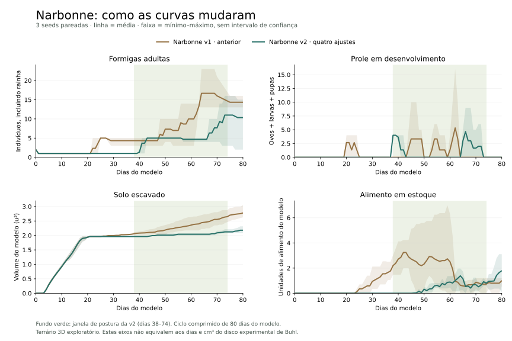

# Narbonne v2 — ciclo, alimentação e locomoção

07/11/2026. Entrega do [PR #124](https://github.com/albreis/viveiro/pull/124).
Novos terrários usam `messor-narbonne@2`. Saves, planos e replays da v1
continuam fixados na versão anterior. O nome identifica a população
histórica de Narbonne, com atribuição provável a _Messor bouvieri_.
A [auditoria de espécie](messor-narbonne.md) mantém a ressalva taxonômica.

## Quatro ajustes implementados

| Ajuste                | Regra da v2                                                                                                                           | Evidência e limite                                                                                                                              |
| --------------------- | ------------------------------------------------------------------------------------------------------------------------------------- | ----------------------------------------------------------------------------------------------------------------------------------------------- |
| Tamanho dos alados    | Rainha/princesa de 11 mm e macho de 8 mm, medidos no corpo da malha, sem asas                                                         | Aproximações declaradas. Não foram confirmadas medidas primárias para esses alados de Narbonne.                                                 |
| Caminhada em galerias | Usa temperatura local do solo, porte, carga de semente e terra e orientação do apoio                                                  | As medianas de caminhada livre de Challet orientam o efeito térmico. Os fatores de parede/teto de 0,82 e carga de terra de 0,85 são hipóteses.  |
| Alimentação           | Cuidadora retira até 0,18 u. da despensa e leva a porção à rainha. Entrega exige mesma câmara, proximidade e contato por espaço livre | Transporte e preparo de sementes são uma abstração granívora. A v2 desativa a troca líquida genérica. O número 0,18 é um coeficiente do modelo. |
| Calendário            | Ano demonstrativo de 80 dias, começando no outono. Postura, produção de alados e voo têm janelas separadas                            | Inspiração qualitativa em Cerdan. Os prazos são comprimidos e não estimam dias biológicos reais.                                                |

As [medidas de caminhada livre](https://doi.org/10.1007/s00040-005-0821-1)
não são velocidades medidas dentro de túneis. A direção dos efeitos de porte
no transporte tem apoio em [Arnan et al., 2011](https://doi.org/10.1007/s00265-011-1197-z).
O [relato de Cerdan, 1989](https://dictionnaire-amoureux-des-fourmis.fr/M/Moissoneuses/Cerdan-Insectes1989-Messor.pdf)
orienta o voo de outono após chuva e o repouso antes da primavera.

A sessão inicia no dia sazonal 59. A primeira janela de postura ocorre
entre os dias decorridos 38 e 74, com limite final exclusivo. Alados
podem ser produzidos entre 64 e 74. A janela inicial de voo termina no
dia 11 e a próxima começa no 76. Chuva recente e condições do habitat
continuam necessárias. O repouso reduz a manutenção da rainha ao fator
0,18. O calendário usa o relógio do modelo, inclusive após restauração.

O multiplicador subterrâneo é aplicado uma única vez em cada passo de
locomoção, inclusive no contorno de parede. A navegação continua limitada
ao apoio físico. Asas, pernas e antenas não entram no comprimento corporal.

## Acesso ao exterior e orçamento de alimento

A investigação encontrou uma inconsistência na versão em rascunho.
Operárias já atravessavam a abertura piloto, mas a rainha continuava em
jejum claustral até a remoção integral do tampão. Em duas de três seeds
ela perdeu saúde apesar de haver alimento armazenado no dia 80.

A v2 agora encerra esse jejum depois da primeira carga de terra
fisicamente depositada no exterior. A mesma operária continua retirando
o tampão restante. Abrir a passagem não cria comida nem remove terra
instantaneamente. A v1 conserva seu critério anterior.

A retirada da porção debita o estoque uma única vez. A entrega transfere
a porção para a rainha sem novo débito. Se a portadora morre, o alimento
vira resíduo no local. A alimentação da prole ainda utiliza o orçamento
coletivo existente. Não há digestão, composição nutricional de sementes
ou mastigação fisiológica calibradas.

## Curvas antes e depois

O [plano fixado](../validacoes/narbonne-v2-80d-plano.json) compara as mesmas
três seeds, v1 e v2, por 80 dias, com 24 °C, umidade do ar 68%, luz 72%,
aleatoriedade 28%, repouso 36° e vento zero. São seis rodadas portáteis
do motor de produção. Cada dia tem 100 passos. Não houve ajuste de
parâmetro para aproximar uma curva de Buhl.



As linhas mostram médias; as faixas são mínimo e máximo entre três seeds.
Essa amplitude não é intervalo de confiança.

| Seed             | Primeira postura v1/v2 | Primeira operária v1/v2 | Acesso externo v1/v2 | Adultos no dia 80 v1/v2 |
| ---------------- | ---------------------- | ----------------------- | -------------------- | ----------------------- |
| SEMENTE-42       | 22,70 / 38,00          | 24,59 / 39,85           | 38,18 / 48,16        | 14 / 15                 |
| NARBONNE-CICLO-1 | 19,14 / 38,00          | 23,16 / 42,12           | 43,43 / 43,72        | 13 / 14                 |
| NARBONNE-CICLO-2 | 19,68 / 38,00          | 21,92 / 40,18           | 59,68 / 42,32        | 16 / 2                  |

Na v1, o marco de acesso coincide com a retirada total do tampão.
Na v2, a retirada termina nos dias 61,45, 67,28 e 79,24, respectivamente.

A média de adultos no dia 80 passa de 14,33 para 10,33, mas duas seeds
terminam com um adulto a mais que antes e a terceira com população muito
menor. A média de solo escavado passa de 2,777 para 2,181 u³. Todas as
rainhas terminam com saúde 100 no indicador do modelo. Esses resultados
descrevem este lote pequeno e o conjunto das quatro mudanças. Não isolam
o efeito causal de cada ajuste e não validam o modelo com dados empíricos.

O erro máximo dos balanços de estoque, reservas maternas e terra foi
5,71 × 10⁻¹³. A [série diária](../validacoes/narbonne-v2-series.csv) e o
[recibo com planos, eventos, hashes e fonte](../validacoes/narbonne-v2-comparacao.json)
permitem reproduzir a coleta. O lote anterior à correção de acesso também
foi preservado em [série](../validacoes/narbonne-v2-pre-acesso-series.csv) e
[recibo](../validacoes/narbonne-v2-pre-acesso-comparacao.json).
Nesse recibo, `fullOpeningTick: null` indica evento não coletado separadamente.

## Reprodução e verificações

A fonte do lote final é `a6267260d1008c0c4f5225c66600480dc9ba31d7`.
O recibo identifica também a fonte matemática e cada CSV oficial.
Em uma pasta nova, executar:

```powershell
node scripts/compare-narbonne-cycle.ts --plan docs/validacoes/narbonne-v2-80d-plano.json --out .runtime/narbonne-reproducao
node scripts/archive-narbonne-cycle.ts --input .runtime/narbonne-reproducao --prefix .runtime/narbonne-reproducao/arquivo --source a6267260d1008c0c4f5225c66600480dc9ba31d7
python scripts/plot-narbonne-cycle.py
```

O gráfico lê as séries arquivadas, confere SHA-256 e requer Matplotlib.
A coleta usa o backend portátil da CLI; execuções nativas têm contrato
numérico distinto. Se o motor mudar, registrar a nova fonte.

- 538 testes passaram, incluindo porções, morte da portadora, apoio, calendário e replay.
- Build TypeScript/Vite e 1.368 mensagens em pt-BR/en conferidos.
- Chrome 157 conferiu os dois idiomas, janelas sazonais, importação de snapshot,
  tamanho da rainha e canvas, sem erros de página.
- A CLI oficial de 80 dias reproduziu o CSV e o manifesto da primeira rodada v2 byte a byte.
- As três curvas de 80 dias da v1 ficaram idênticas ao lote anterior.
  CSV e manifesto antigos de 12 dias da v1 também ficaram idênticos.
- O controle de 50 operárias na arena de Buhl preservou as duas amostras
  arquivadas de 20 minutos. Esse controle verifica regressão nesse trecho;
  não substitui nova avaliação completa de 72 h.
- O replay portátil após a primeira saída reproduziu 200 passos e a
  remoção física do restante do tampão foi verificada.

B7 continua dependendo de séries empíricas independentes. Esta comparação
usa o terrário 3D e seus dias acelerados; não deve ser sobreposta aos
cm³ e segundos do disco de Buhl como se fossem o mesmo protocolo.
