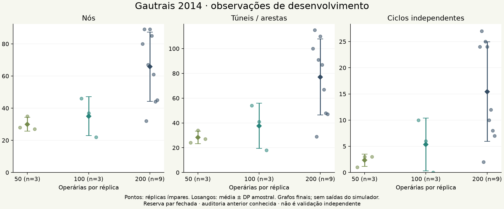

# Gautrais: primeira análise de desenvolvimento

15/11/2026. Entrega G1, dependente do [PR #134](https://github.com/albreis/viveiro/pull/134), implementada no [PR #135](https://github.com/albreis/viveiro/pull/135).
A fonte de análise foi congelada no commit `57f65fc3fe791f5cf6f6057d6111898db187703e`, Node v24.22.1. O [plano](gautrais-2014-plano.json) foi enviado no commit 794f3d0 antes destas métricas.

## O que foi executado

15 réplicas ímpares de desenvolvimento: três de 50, três de 100 e nove de 200 operárias. Os 15 grafos finais e sete quadros de cada uma das 12 séries disponíveis geram 99 observações. O grupo 50 não tem quadros temporais no suplemento. As 13 réplicas pares permanecem sem nova análise de métricas.

Todos os 5.019 arquivos passaram pelo hash do inventário de 04/11. Isso lê os bytes de reserva somente para integridade. Não chama o cálculo de suas métricas. O CLI só aceita a partição development e recusa saída existente, escrita dentro dos dados brutos, fonte sem commit e plano alterado.

## Resultados observados, sem predições do Viveiro

Média ± desvio-padrão amostral entre réplicas; não é intervalo de confiança.

| Operárias | Réplicas | Nós | Arestas | Ciclos independentes |
| --- | --- | --- | --- | --- |
| 50 | 3 | 30.00 ± 4.36 | 28.33 ± 5.13 | 2.33 ± 1.15 |
| 100 | 3 | 35.00 ± 12.12 | 37.67 ± 18.23 | 5.33 ± 5.03 |
| 200 | 9 | 65.78 ± 21.57 | 77.11 ± 30.62 | 15.44 ± 9.49 |



13 grafos finais de desenvolvimento têm mais de um componente. Há 4 arestas paralelas adicionais nesse recorte, preservadas. Os ciclos usam E − N + C; não se impõe C = 1. Grau, ramificação e pontas são diagnósticos de multigrafo, não uma interpretação física automática de cada ligação. Meshedness fica pendente da convenção de periferia, conectividade e planaridade.

[Dados gerados, não editar à mão](gautrais-2014-desenvolvimento.json). O relatório contém cada réplica e os sete quadros selecionados, com instante nominal e métricas. Não converte coordenadas/larguras em volume.

## Reprodução

Baixar e conferir o suplemento conforme o [inventário original](gautrais-2014.md). Em checkout limpo deste commit ou de descendente com o mesmo leitor:

```sh
node scripts/analyze-gautrais.ts --source .runtime/buhl-gautrais-s1/S12 --output .runtime/gautrais-nova-saida
python scripts/plot-gautrais-development.py .runtime/gautrais-nova-saida/development.json .runtime/gautrais-nova-figura.png
```

O gráfico requer Matplotlib. A reprodução numérica do CLI requer apenas as dependências Node do projeto; o ZIP bruto não é redistribuído aqui. Uma segunda saída tem metadados do commit em execução, sem substituir a primeira. Campos de grupos/réplicas da versão inicial e da correção de aritmética coincidiram exatamente.

## Alcance e próximo passo

A auditoria anterior examinou todos os grafos e suas médias. A divisão por IDs é determinística e foi fixada antes desta análise, mas não torna a reserva inédita nem independente. Gautrais reutiliza experimentos de Buhl 2004; a sobreposição com 2001/2005 não está resolvida. Não há calibração, predições do motor, MAE ou cobertura nesta entrega.

G2 deve extrair o mesmo observável do simulador, incluindo câmaras, periferia e componentes; o grafo lógico do World não pode ser equiparado diretamente à segmentação física do artigo. G3 congela cenário e predições antes de G4 avaliar a reserva. B7/P3.3 continuam abertos, sem depender de e-mail.

## Verificação técnica

16 testes dirigidos de grafo, partição, aritmética e cronograma passaram. A regressão completa e a conferência pt/en no navegador estão em execução; serão registradas antes de concluir o PR. As duas falhas da primeira rodada foram a operação de potência na estatística e uma data antiga fixada no teste; nenhuma regra biológica foi alterada.

[Fonte e crédito](https://doi.org/10.1371/journal.pone.0109436): Gautrais, Buhl, Valverde, Kuntz e Theraulaz (2014), Data S1. [Protocolo G0–G4](../planejamento/gautrais-avaliacao.md).
