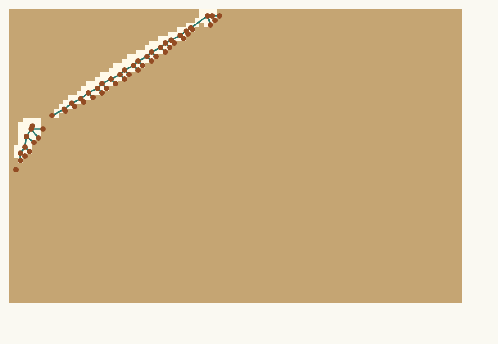

# G2 — Piloto do observador físico do World

15/11/2026. **Instrumentação entregue; comparabilidade ainda não aprovada.**
O alvo continua o World. Não foram calculadas novas métricas de reserva.

## Fonte e reprodução

Fonte do ensaio: `cd4ddf0c16f3345d1569ae08e2613739c8970ba8`.
Fingerprint do modelo:
`6c8705794ea595829faa96afa6f3986e9fe374a60b906e1a702dc4565314bb93`.
Node 24.22.1. [Plano fixado](gautrais-g2-piloto-plano.json),
[dados e imagens de todos os cortes](gautrais-g2-piloto/world-observation.json).

```powershell
node scripts/observe-gautrais-world.ts --plan docs/validacoes/gautrais-g2-piloto-plano.json --output .runtime/gautrais-g2-nova-reproducao
node scripts/qa/gautrais-g2.mjs
```

O QA usa o piloto arquivado localmente em `.runtime/gautrais-g2-piloto`.
O CLI exige fonte limpa e pasta de saída inexistente; não substitui resultados.
Uma reprodução em outro commit recebe sua própria identidade de fonte.

## Resultado computacional

54 cortes: três coortes (50/100/200), três instantes (0/60/120 ticks), três
alturas e duas resoluções. O observador consulta o campo físico de solo,
não o grafo lógico de roteamento. Todos os cortes conservaram os componentes
e buracos de sua máscara; o snapshot inteiro ficou idêntico antes/depois
da observação. Chrome 157.0.8103.51 reproduziu **exatamente** as 54 leituras
numéricas do CLI, em contexto novo, sem erros de página.

573/573 testes e build estrito/i18n/Vite passaram. Os testes incluem 512
máscaras locais, 1.500 máscaras irregulares, árvores/anéis, contatos diagonais,
arestas paralelas, bloqueios e conexões geométricas ausentes do grafo lógico.
[Recibo](gautrais-g2-qa.json).

## Limitação medida: resolução

A igualdade topológica com a máscara **não** garante que a máscara ou suas
ramificações representem fielmente a geometria contínua. Neste piloto os
valores abaixo são iguais nos três grupos e nos três instantes. A/B significa
pitch 0,2/0,25, em unidades do modelo; não são mm.

| Corte y | Nós A/B | Arestas A/B | Componentes A/B | Ciclos A/B |
| --- | --- | --- | --- | --- |
| −1 | 14 / 6 | 10 / 2 | 4 / 4 | 0 / 0 |
| −2 | 56 / 37 | 53 / 35 | 3 / 2 | 0 / 0 |
| −3 | 4 / 4 | 3 / 3 | 1 / 1 | 0 / 0 |

O corte central mostra ramificações de pixels ao longo de galerias diagonais.
Logo N/E e a segmentação ainda não passaram por convergência de resolução.
Não escolher uma grade pela proximidade aos dados empíricos. Mesmo a estabilidade
dos ciclos neste piloto não demonstra estabilidade para todo ninho.



São cortes horizontais de um ninho procedural maduro; não o disco sem galerias
do laboratório. A ausência de mudança nessas contagens em 120 ticks não mede
volume total escavado nem 72 horas físicas.

## Próximo passo e trava de interpretação

**G2 permanece aberto** para convergência/segmentação e convenção comum com os
grafos observados. A supressão de grau 2 produz N/E normalizados, não as
contagens originais de câmaras do artigo. O plano G1 não foi alterado.

Em paralelo, K1 deve preparar disco sem galerias no World, coorte adulta,
relógio físico/biológico e balanço de material, sem mudar saves existentes.
Somente depois de ambos passarem será possível congelar G3 e abrir G4.
O piloto declara `physicalProtocolCompatible: false` e `g3.ready: false`.
Não é calibração nem validação quantitativa do terrário.
